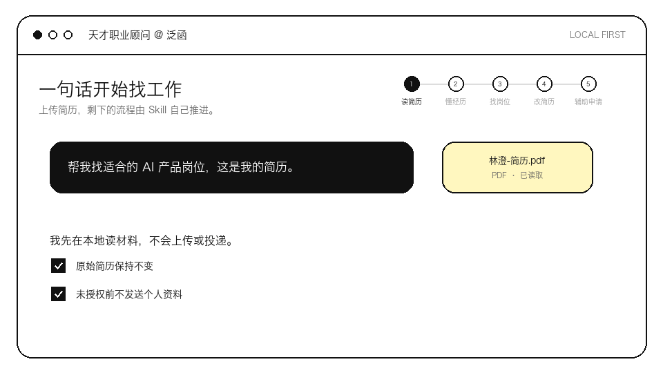
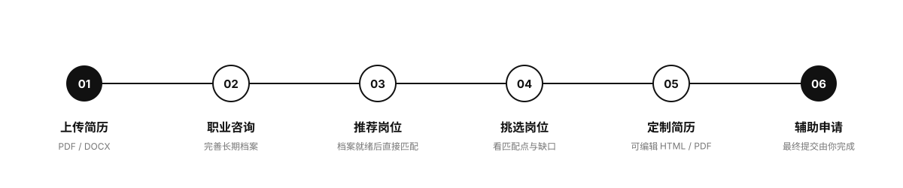
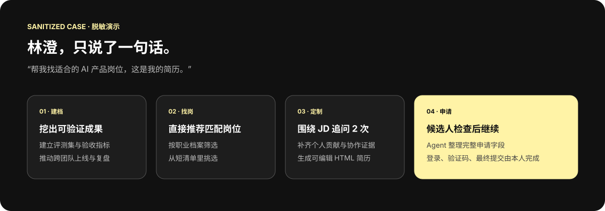
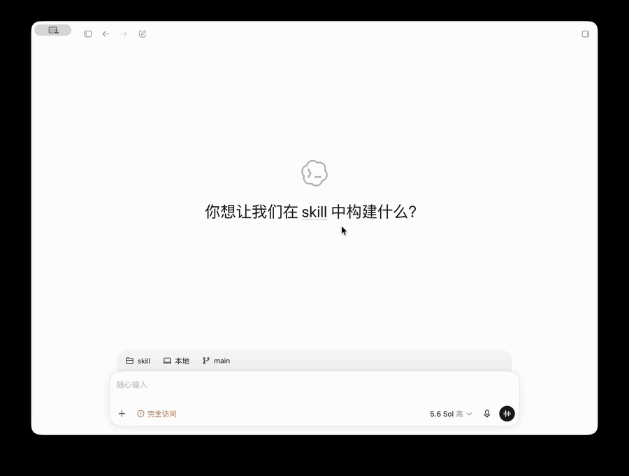
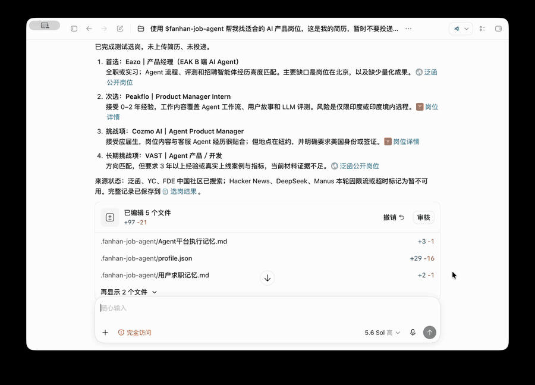
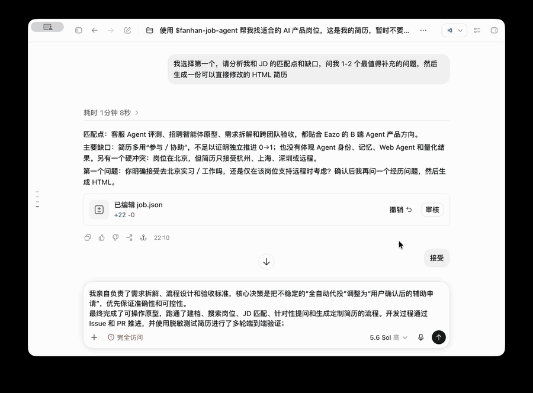
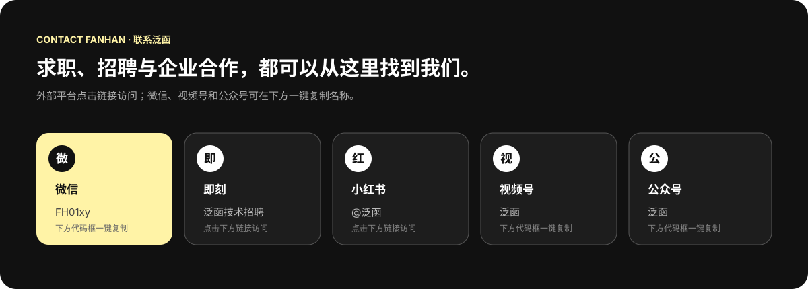

<div align="center">

# 天才职业顾问

### 让你的 Agent 真正了解你，再帮你找工作

上传一份简历，建立可以长期复用的职业档案。<br>
档案就绪后直接推荐匹配岗位，针对每个 JD 完善经历、生成专用简历并辅助申请。

<p>
  <a href="#快速开始"><strong>开始使用</strong></a>
  &nbsp;&nbsp;·&nbsp;&nbsp;
  <a href="#它是怎么工作的"><strong>查看流程</strong></a>
  &nbsp;&nbsp;·&nbsp;&nbsp;
  <a href="#真实能力边界"><strong>能力边界</strong></a>
</p>



<sub>这段录屏已经过期。画面里的调用方式和岗位都不要当成现在的用法，也不要当成正在招聘的职位。合并后需要重录。</sub>

</div>

---

## 它不只是帮你改简历

普通 AI 往往只看当前简历，改几句话，然后忘记你是谁。

天才职业顾问会先理解你的真实经历，把一次沟通沉淀成长期职业档案，再把这些信息用于找岗、选岗、定制简历、辅助申请和后续面试准备。

<table>
<tr>
<td width="33%" valign="top">

### 01　先了解你

读取 PDF 或 DOCX，通过简短咨询挖掘成果、个人贡献、关键判断和可验证结果。

</td>
<td width="33%" valign="top">

### 02　再帮你选

档案就绪后直接给出可以挑选的匹配岗位。不会先请你确认招聘渠道。泛函开放岗位要等你明确要求；当前还没有不带密钥的公开清单。

</td>
<td width="33%" valign="top">

### 03　最后帮你投递

结合具体 JD 补充经历、预览确认可编辑简历，再用 EgoLite 填写并提交你选中的岗位。

</td>
</tr>
</table>

---

## 它是怎么工作的



### 1. 上传原始材料

把简历发给 Agent。作品集、GitHub 和个人网站都是可选材料，不会因为缺少链接阻止建档。

### 2. 建立长期职业档案

Agent 先读材料，再围绕最有潜力的一段经历逐步追问。每次只问一个问题，不让你重新填写一张长表。

### 3. 直接推荐匹配岗位

档案准备好之后，直接搜索并给出一份可以挑选的短清单。公司官网和多个公开招聘平台会一起查，匹配的职位合成同一份清单。不会先请你确认招聘渠道，也不会展示渠道类型、访问门槛或风险说明。

### 4. 判断并挑选

同一份职业档案用来筛选、去重和排序。每条岗位写明公司、职位、地点、链接、匹配点和缺口。重复岗位会合并。岗位卡片可以带它自己的链接。泛函开放岗位要等你明确要求。当前还没有不带密钥的公开清单，技能不会改用旧工作台，也不会把过期职位当成正在招聘。

### 5. 生成岗位专用简历

你选定岗位后，Agent 会针对 JD 再问 1–2 个最值得补充的问题，生成可以直接修改的 HTML 简历。整页文字都能直接编辑，修改会自动保存在当前浏览器；确认无误后，由你本人生成并下载 PDF，再把文件发回当前对话。

> 这不是一份只能接受或推翻的 AI 成稿。你可以先改姓名、描述和项目细节；每次继续修改后，旧下载链接都会失效，避免误投过期版本。

### 6. EgoLite 完成申请

Agent 用 EgoLite 读取完整申请表、填写并回读字段。你选岗并确认岗位专属简历后，默认自动提交；如果你说“我自己提交”，就停在最终按钮前。登录、验证码、敏感字段、事实冲突和结果不明确时一定暂停让你处理。

---

## 快速开始

### 安装

只需安装这一个技能。

```bash
npx skills add https://github.com/Ivor-NCUT/genius-career-advisor-skill \
  --skill genius-career-advisor -g -a codex -y
```

`--skill` 后面的标识只用于安装器选择这一个包。装好之后对用户说 `$天才职业顾问`。

也可以直接告诉你的 Agent：

```text
请安装这个仓库中的天才职业顾问，安装包标识用 genius-career-advisor，只安装这一个技能：
https://github.com/Ivor-NCUT/genius-career-advisor-skill
```

<details>
<summary><strong>手动安装到 Codex</strong></summary>

```bash
git clone https://github.com/Ivor-NCUT/genius-career-advisor-skill.git

mkdir -p "${CODEX_HOME:-$HOME/.codex}/skills"

cp -R genius-career-advisor-skill/genius-career-advisor \
  "${CODEX_HOME:-$HOME/.codex}/skills/"
```

</details>

### 第一句 Prompt

上传简历，然后只需要说：

```text
使用 $天才职业顾问 帮我找适合的工作，这是我的简历。
```

剩下的建档、咨询和岗位推荐，由它自己推进。

---

## 常用场景

### 一个完整的使用案例

林澄（虚构候选人）上传一份普通简历，只说了一句话。Skill 先从材料中建立长期职业档案，档案就绪后直接推荐匹配岗位；选定岗位后，围绕 JD 追问两项关键事实，最后生成可编辑简历并整理申请表。



#### 演示 1：从一句话启动职业建档

上传简历并说明求职方向后，Skill 会读取材料、初始化本地职业档案，并确认进入岗位推荐前最关键的求职条件。



#### 演示 2：围绕 JD 分析并补充经历

选定岗位后，Skill 会比较 JD 与职业档案，说明匹配点、缺口和风险，再追问 1–2 个最值得补充的问题。



#### 演示 3：生成可编辑的岗位专用简历

候选人补充事实后，Skill 会生成可直接修改的 HTML 简历；候选人检查内容后，可以导出 PDF 并继续申请。



<sub>上面三段都是过期录屏。它们使用过旧的调用方式，也出现过当时的测试岗位。不要把画面里的公司、城市或职位当成现在正在招聘的岗位。合并后需要重录。</sub>

> 自动投递只对候选人明确选中的岗位生效。候选人必须先检查岗位专属简历，也可以随时要求自己点击最终提交。

### 先找岗，暂时不投递

```text
请先建立我的职业档案。档案就绪后直接推荐匹配岗位，
先展示公司、职位和匹配情况，暂时不要投递。
```

想看泛函开放岗位时，直接说「也搜索泛函」。这不是默认步骤。如果公开清单还没有准备好，技能会说明现在列不出来。

### 针对一个岗位完善简历

```text
我想申请这个岗位。请先分析匹配点、缺口和风险，
再问我 1–2 个最值得补充的问题，最后生成一份可编辑的岗位专用简历。
```

### 准备申请表

```text
我确认申请这个岗位。请读取完整申请表，能可靠填写的帮我填写；
不能填写的字段一次性整理给我；这次最终提交由我点击。
```

### 进入面试准备

```text
我已经进入这个岗位的面试阶段，请根据我的职业档案和 JD 帮我模拟面试。
一次问一个问题。
```

---

## 真实能力边界

| 能力 | 当前状态 |
|---|---|
| PDF / DOCX 材料读取与职业档案 | 已支持 |
| 首次五维职业咨询与长期本地记忆 | 已支持 |
| 档案就绪后直接推荐匹配岗位 | 已支持。会同时检索公司官网和多个公开招聘平台，但不会先请你确认渠道 |
| 多来源岗位发现与统一整理 | 已支持。官网和公开平台的命中职位合成一份清单。泛函开放岗位要等你明确要求；目前没有不带密钥的公开清单 |
| 用户主动提供的招聘网站 | 可以纳入当次查看；不承诺所有网站均可稳定读取。分享到内部清单前仍需单独同意 |
| 快速初筛与选岗后深度评估 | 已支持；硬条件、事实证据、未知项分开呈现，不使用无依据的数字分数 |
| 公司事实核验 | 已支持；关键结论保留来源和核验日期 |
| JD 匹配分析与 1–2 个针对性问题 | 已支持 |
| 可编辑 HTML 简历、草稿自动保存与用户下载 PDF | 已支持；编辑和 PDF 生成均在本地页面完成 |
| EgoLite 外部申请表填写 | 已支持选岗后的填写、字段回读与真人接管流程，效果受网站能力影响 |
| 申请结果记录与复盘 | 已支持；面试、拒绝、Offer、撤回和有限次数跟进保存在本地 |
| 最终提交 | 用户选岗并确认岗位专属简历后默认自动提交；可明确切换为本人点击 |
| 泛函材料送达 | 可选项。只有你明确要求并同意授权文案后，才把材料交给泛函招聘团队并保存在 Twenty 招聘 CRM |
| WorkBuddy | 已完成安装、触发与材料采集烟测；完整外部申请仍走同一套 EgoLite 流程 |

> 这不是一个“自动海投 63 个网站”的工具。它提供的是可检查、可暂停、可由用户接管的求职工作流。

---

## 隐私与控制

- 原始材料默认只在当前本地环境处理。
- 未经明确授权，不向泛函或招聘网站发送简历、联系方式和作品集。
- 候选人同意交给泛函后，材料由招聘团队保存在 Twenty 招聘 CRM。操作者的 webhook 地址和密钥只留在本机，不进入仓库，也不向候选人索取。
- 不保存招聘网站密码、Cookie、验证码或登录状态。
- 当前打开的网页不代表用户选择了这个岗位；只有明确选岗才可投递。
- 发送个人信息前必须说明接收方、字段范围和提交模式。
- 岗位、JD、简历、字段或最终动作变化后，原投递授权立即失效。
- 验证码、风控和结果不明确时不会绕过、重试或猜测成功。

详细规则见 [隐私与本地存储](genius-career-advisor/references/privacy-and-storage.md)。

---

## 方法借鉴与致谢

岗位分层评估、公司事实核验和申请结果复盘的方法借鉴自 [MadsLorentzen/ai-job-search](https://github.com/MadsLorentzen/ai-job-search)；官网校招核验、个人资料模板和投递台账设计参考 [Romee-w07/job-apply-skill](https://github.com/Romee-w07/job-apply-skill)。两者均采用 MIT License。本仓库沿用自己的职业档案、可编辑简历、EgoLite 2.x 和授权指纹实现，没有复制旧版浏览器指令或个人数据。

---

## 可选：把职业档案交给泛函

天才职业顾问可以独立运行在你自己的 Agent 中。默认流程到选岗、定制简历和你确认后的申请为止。是否把职业档案交给泛函，是另一个需要单独确认的选择，不会在投递结束后自动开始。

<table>
<tr>
<td width="50%" valign="top">

### 对候选人

- 招聘团队人工审核职业档案；
- 匹配泛函自己的岗位和合作企业岗位；
- 出现合适机会时主动联系；
- 为优秀候选人提供企业推荐或内推；
- 进入面试后继续复用同一份职业档案准备表达。

</td>
<td width="50%" valign="top">

### 对企业

- 发布 AI、Agent、产品与技术岗位；
- 获取经过职业咨询和材料核验的候选人；
- 由泛函完成初步筛选、推荐和后续招聘协作；
- 按现有企业招聘与猎头服务方式合作。

</td>
</tr>
</table>


<div align="center">
  <a href="#快速开始"><strong>我是候选人｜免费开始使用</strong></a>
  &nbsp;&nbsp;·&nbsp;&nbsp;
  <a href="https://applink.feishu.cn/client/bot/open?appId=cli_aaff15aa85795bee"><strong>我是企业｜在飞书联系泛函招聘团队</strong></a>
</div>

---

## 开发者说明



| 平台 | 联系方式 |
|---|---|
| 即刻 | [打开「@泛函」主页](https://okjk.co/47fXxa) |
| 小红书 | [打开「@泛函」主页](https://xhslink.cn/o/6D14yTWuPLq) |
| 飞书 | [打开泛函招聘顾问](https://applink.feishu.cn/client/bot/open?appId=cli_aaff15aa85795bee) |
| 邮箱 | [fanhan@aimanziyi.vip](mailto:fanhan@aimanziyi.vip) |

微信号（点击代码框右上角复制）：

```text
FH01xy
```

视频号、公众号名称（点击代码框右上角复制）：

```text
泛函
```

### 内推接收配置（仅操作者本机）

不要把 webhook 地址或密钥写入仓库。从 Grok Bot 例程面板「天才职业顾问内推接收」复制后，在运行 Skill 的环境里设置：

- `FANHAN_GROK_BOT_WEBHOOK_URL`
- `FANHAN_GROK_BOT_WEBHOOK_KEY`

也可以写成未被 Git 跟踪的 `.天才职业顾问/grok-bot-referral.json`。字段为 `webhook_url` 和 `webhook_key`。两项必须同时设置。缺失时技能会停止并提示操作者，不会向候选人索取。只有候选人明确要求把材料交给泛函时才会用到这项配置。

<details>
<summary><strong>仓库结构</strong></summary>

- `genius-career-advisor`：唯一的技能目录，也是安装器要求的包标识。里面只有一份 `SKILL.md`。对用户的产品名和调用名是「天才职业顾问」/ `$天才职业顾问`。
- `docs`：外部网站、第三方项目与工作台接入审计。
- `third_party`：第三方许可证留档。

</details>

---

<div align="center">

### 找工作，不应该从每次重新介绍自己开始

一次建立职业档案，持续用于找岗、申请和面试准备。

Maintained by [Ivor-NCUT](https://github.com/Ivor-NCUT) and [Zkkk-web](https://github.com/Zkkk-web)

</div>
